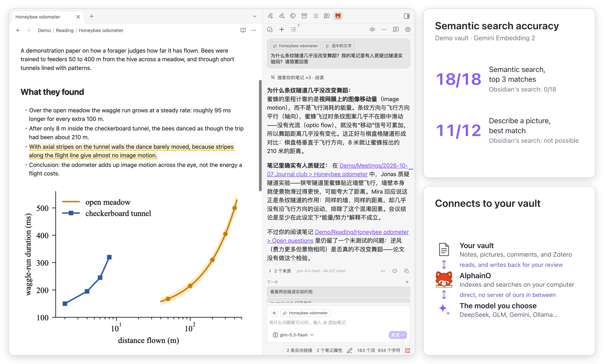

<p align="center">
  <picture>
    <source media="(prefers-color-scheme: dark)" srcset="docs/images/header-en-dark.svg">
    
  </picture>
</p>

<p align="center">
  <a href="https://github.com/Alphainfix/AlphainO/releases/latest"></a>
  <a href="https://obsidian.md"></a>
  <a href="LICENSE"></a>
</p>

<p align="center">
  <a href="https://github.com/Alphainfix/AlphainO">GitHub</a> ·
  <a href="https://github.com/Alphainfix/AlphainO/releases/latest">Download</a> ·
  <a href="https://github.com/Alphainfix">Author: Alphainfix</a>
</p>

<p align="center"><b>English</b> · <a href="README.zh-CN.md">简体中文</a></p>

**Free and open source. Customize it your way.** AlphainO is a research assistant inside Obsidian. You chat
with it about your notes using your own models and API keys, and there is no account to sign up for. It is
the Obsidian sibling of [AlphainZ](https://github.com/Alphainfix/AlphainZ), the assistant in Zotero: the two
share their model layer and chat, and [work together](#working-with-alphainz-in-zotero), so one question can
draw on your notes and your papers at once. Your questions go from your computer straight to the model
provider you choose, with no one else's server in between: simple, safe and [affordable](#cost).

<p align="center">
  
</p>

## What it does

### Ask your whole vault

AlphainO decides how to look, and combines:

- **A vector index of your notes.** Every note is cut into passages and embedded, either by a cloud model
  (Gemini Embedding 2, OpenAI) or by one on your own computer (EmbeddingGemma 2 in Ollama). Search matches
  by meaning: a question finds the passages that mean the same thing even when they share no words, or are
  in another language. Indexing runs in the background and can be switched off.
- **Semantic picture search.** With an embedding model that also reads images, the pictures in your vault are
  indexed too: describe a screenshot, a photo or a chart, and AlphainO finds it and shows it in the answer.
  Off by default, because the pictures go to the embedding provider.
- **Answers link their sources.** Notes are cited as links to the heading they rest on (`[[Note#Heading]]`),
  so a click takes you there.
- Keyword search, titles, tags, properties, folders and dates, and the links and backlinks between notes.

### Ask about what you are reading

Select a passage, in the editor or in Reading view, and choose **Ask AlphainO about this** or **Explain**
from the right-click menu; or ask about the open note in the side pane, and add other notes with "@".

### Keep the answer with the passage

A question asked from a selection is anchored to the passage. When the answer is in, a card at the bottom of
the chat saves it as a comment on that passage: the comment stays with its text when the note changes, and
syncs with your vault.

### Edits you review

When AlphainO changes a note, the change goes in at once and one undo takes it back. Every changed span is
marked, with **Accept** and **Reject**: like reviewing a pull request, one change at a time or all at once.

### Working with AlphainZ in Zotero

AlphainO and [AlphainZ](https://github.com/Alphainfix/AlphainZ) are the same assistant in two places, and
they work as one:

- **Your papers, from your notes.** While Zotero runs with AlphainZ's MCP server on (AlphainZ: Settings →
  Advanced → MCP Server), AlphainO can use AlphainZ's library tools: search your library by metadata, topic
  or the meaning of the full text, find figures from a description, read papers and look at their pages, and
  read your highlights and comments. One question can then draw on your notes and your papers together.
- **One way of working.** Both use the same models, the same settings pages and the same chat, and keep
  conversations in the same format. Settings → Zotero library (AlphainZ) checks the connection, or turns it
  off.

### And more

- **Comments on passages.** Comment on any passage from the right-click menu. AlphainO reads every comment
  together with its passage, and can add, answer and resolve them. Each change to a comment is its own small
  file, so comments sync between computers without conflicts.
- **Use multiple computers.** Conversations and comments are files in your vault and travel with it
  (Obsidian Sync, iCloud Drive, ...). API keys never leave the computer you entered them on.
- **In English or Chinese.** The interface follows Obsidian's language.
- **Serve other agents.** Turn on Settings → Claude (MCP), and Claude Code can connect over HTTP, or Claude
  Desktop through a small bridge AlphainO keeps in its plugin folder. While Obsidian is open, they can search
  your vault by keyword, meaning or metadata, find pictures from a description, read notes and their links,
  read and write comments, and propose edits that you review.
- **Link to a conversation.** Copy a chat's link from its menu and paste it into a note; clicking it opens
  the chat.

## Accuracy of semantic image and text search

**A demonstration vault.** 18 notes and 12 pictures written for this repository ([`docs/benchmark`](docs/benchmark)):
reading notes, ideas and journal-club notes about AlphainZ's six demonstration papers, three unrelated personal
notes, and the papers' twelve figures pasted in as pictures. Each subject has several notes, so a question has
to find the right one among its neighbours. 36 questions were run through AlphainO's search with no language
model involved. The semantic questions avoid the notes' own words, so only a match by meaning can find them;
the twelve picture descriptions are AlphainZ's figure questions, unchanged:

| Question | AlphainO with<br>EmbeddingGemma&nbsp;2<br>(local, free) | AlphainO with<br>Gemini&nbsp;Embedding&nbsp;2<br>(your own API key) | Obsidian's<br>built&#8209;in&nbsp;search |
|---|:-:|:-:|:-:|
| Semantic search,<br>English questions (12) | 10 best matches,<br>12 top-3 matches | 11 best matches,<br>12 top-3 matches | 0 of 12 matched |
| Semantic search, Chinese<br>questions on English notes (6) | 5 best matches,<br>5 top-3 matches | 4 best matches,<br>6 top-3 matches | 0 of 6 matched |
| Describing a picture (12) | 7 best matches,<br>11 top-3 matches | 11 best matches,<br>12 top-3 matches | not possible |
| Exact keywords (6) | 5 of 6 best matches¹ | 6 of 6 best matches | 6 of 6 matched |

¹ Semantic search alone. AlphainO also searches by keyword, which ranks all six first.

A picture in a note is indexed on its own. AlphainZ, which indexes whole PDF pages, matched the same twelve
descriptions best 6 times with Gemini Embedding 2 and 5 times with EmbeddingGemma 2.

## Compared with similar tools

Copilot, Claudian and Smart Connections are the three most-downloaded AI plugins in Obsidian's directory;
YOLO, the maintained fork of Smart Composer, is the closest to AlphainO in what it does.

| | AlphainO | Copilot | Claudian | Smart&nbsp;Connections | YOLO |
|---|:-:|:-:|:-:|:-:|:-:|
| Works inside Obsidian, on your own vault | ✅ | ✅ | ✅¹ | 🟡 search only² | ✅ |
| Searches the whole vault by meaning | ✅ | 🟡 via Miyo³ | ❌¹ | ✅ | ✅ |
| Finds a picture from a description | ✅ | 🟡 text in images³ | ❌¹ | – | ❌ |
| Edits notes, with a review of each change | ✅ | ✅ | ✅ | 🟡 Pro only⁴ | ✅ |
| Reads and writes comments on passages | ✅ | 🟡 published pages only⁵ | – | – | ❌⁶ |
| Uses your Zotero library | ✅ via AlphainZ | – | – | – | – |
| Your own API key, any OpenAI-compatible endpoint | ✅ | ✅ | 🟡 through the agents¹ | 🟡 Pro only² | ✅ |
| Local models through Ollama | ✅ | ✅ | – | 🟡 Pro only² | ✅ |
| No account, no subscription | ✅ | ✅⁷ | ✅ | 🟡 core only² | ✅ |
| Serves your vault to other agents (MCP) | ✅ | 🟡 via Miyo³ | ❌ | 🟡 Pro only⁴ | ✅ |
| Open source | ✅ AGPL | ✅ AGPL⁸ | ✅ MIT | 🟡 source available⁹ | ✅ MIT |

✅ offered · 🟡 partly · ❌ not offered, according to the product's own pages · – not stated. Checked in late November 2026 from each project's README, docs, pricing pages and source code; corrections are welcome.<br>
¹ Claudian runs agent CLIs you install and sign in to yourself (Claude Code, Codex, OpenCode and others), with the vault as their working folder; their keys go in each agent's own settings. It adds no index: the agents find files with their own file and text search.<br>
² Smart Connections 4 has no chat: it lists related notes and searches by meaning with a local model. Chat is the separate Smart Chat plugin, whose free part opens the ChatGPT, Claude or Gemini website; your own API key or a local model, Ollama included, needs Pro ($30 a month or $299 a year).<br>
³ Copilot 4 moved search by meaning into Miyo, a separate desktop app from the same company, free on your own computer, whose source is not published. Miyo reads the text in images; its MCP connector is free for agents on the same computer, while ChatGPT and Claude on the web or phone need a paid Miyo plan.<br>
⁴ With the paid Connect Pro, other agents can use the vault; edits they propose wait in an inbox for your approval, but its other write tools change notes directly.<br>
⁵ Only on notes published to OpenArtifacts with a paid plan: people comment on the published page, and the agent revises the note, replies and resolves the threads.<br>
⁶ An annotation mode (AI annotations and suggestions on notes) is on YOLO's roadmap.<br>
⁷ The free path needs no account, licence key or card; Copilot-hosted models, Quick Chat's automatic vault search and publishing need a paid plan.<br>
⁸ The plugin is AGPL; the servers behind its hosted features are closed, and Miyo's source is not published.<br>
⁹ The Smart Plugins License bars using the code in a competing Obsidian product, so it is source available, not OSI open source.

General tools such as NotebookLM, or a ChatGPT or Claude project, answer from copies of your notes uploaded to them,
outside Obsidian, and don't write back into your vault.

## Models

Built in: DeepSeek, OpenRouter, Zhipu (BigModel), Google Gemini, OpenAI, and Ollama on your own computer.
Anything else that speaks the OpenAI API, such as a proxy, an institutional gateway or a local server, can
be added by hand, on Chat Completions or on the Responses API.

The model settings are AlphainZ's: each model can be told which thinking levels it takes (the Thinking menu
then offers exactly those), how large its context window is, and the most output one answer may use.

## Cost

AlphainO itself is free; what you pay is the model provider's token price. AlphainO runs on AlphainZ's
model layer, where 62 real questions averaged about 80,000 tokens read per question (83% of them from the
provider's cache) and about 3,000 written. At the providers' list prices:

| Model | Per question | 100 questions a day |
|---|:-:|:-:|
| DeepSeek V4.1 Flash | about $0.004<br>($0.008 at peak hours) | about $0.40 |
| OpenAI gpt-6-luna | about $0.004 | about $0.40 |

So even a heavy day of 100 questions costs about 40 cents. A local model in Ollama costs nothing.
Indexing is separate: free with EmbeddingGemma 2 on your own computer; with Gemini Embedding 2, about $0.20
per million tokens of notes (most vaults are well under a million) and about $0.12 per 1,000 pictures.

List prices as of late November 2026. DeepSeek charges double on weekdays during Beijing business hours
(01:00–04:00 and 06:00–10:00 UTC).

## Install

1. Download `main.js`, `manifest.json` and `styles.css` from the
   [latest release](https://github.com/Alphainfix/AlphainO/releases/latest).
2. Put them in `<your vault>/.obsidian/plugins/alphaino/`, then turn AlphainO on in Settings → Community
   plugins. Desktop only; Obsidian 1.11.4 or later.
3. Open AlphainO from its ribbon icon, then Settings → AlphainO → Model: add a provider, paste a key and pick
   a model.

## Privacy

- Your questions, and the parts of your notes they need, go from your computer straight to the model provider
  you chose. There is no AlphainO server.
- With search by meaning on, your notes are sent to the embedding provider to be indexed; with picture search
  on, so are your pictures, shrunk first.
- AlphainO also talks to programs on your own computer: Ollama (`127.0.0.1:11434`) if you use it, and Zotero
  (`127.0.0.1:23119`) to reach AlphainZ. Its MCP server, once you turn it on, listens on `127.0.0.1:23129` and
  answers only requests from this computer.
- API keys stay in Obsidian's secret storage on the computer you entered them on. The plugin's settings file,
  which syncs with your vault, holds only the name of each key.
- Conversations and comments are files in `Agent/.alphaino/` (or `.alphaino/` at the vault root), a hidden
  folder Obsidian leaves out of search. The search indexes stay in Obsidian's local storage on each computer.
- No telemetry, no account, and no code downloaded while it runs. Apart from that local storage, AlphainO
  reads and writes only inside your vault.

## Building from source

```bash
git clone https://github.com/Alphainfix/AlphainO.git
cd AlphainO/plugin
npm ci
npm run build        # writes build/main.js, build/manifest.json and build/styles.css
npm test
npm run smoke        # drives the built plugin in a stand-in Obsidian against a fake model server
```

The code AlphainO shares with AlphainZ is copied into [`plugin/shared/`](plugin/shared/README.md).

## Changelog

- **0.0.1** (2026-11-26): the first version.

Full notes for each version are on the [releases page](https://github.com/Alphainfix/AlphainO/releases).

## License

AlphainO is free software under the [GNU Affero General Public License v3.0 or later](LICENSE), like
AlphainZ and Beaver, whose code it shares.

- [AlphainZ](https://github.com/Alphainfix/AlphainZ): the model layer, the chat and the model settings.
- [Beaver](https://github.com/jlegewie/beaver-zotero), by Joscha Legewie: the plugin AlphainZ is based on.
- Orbit Comments: the comment anchors and their file format (MIT; its notice is kept in
  `plugin/src/comments/anchor.ts`).

Comparison sources: [Copilot](https://github.com/logancyang/obsidian-copilot), [Claudian](https://github.com/YishenTu/claudian), [Smart Connections](https://github.com/brianpetro/obsidian-smart-connections) and [smartconnections.app](https://smartconnections.app), [YOLO](https://github.com/Lapis0x0/obsidian-yolo); download counts from Obsidian's [community-plugin-stats.json](https://github.com/obsidianmd/obsidian-releases).
