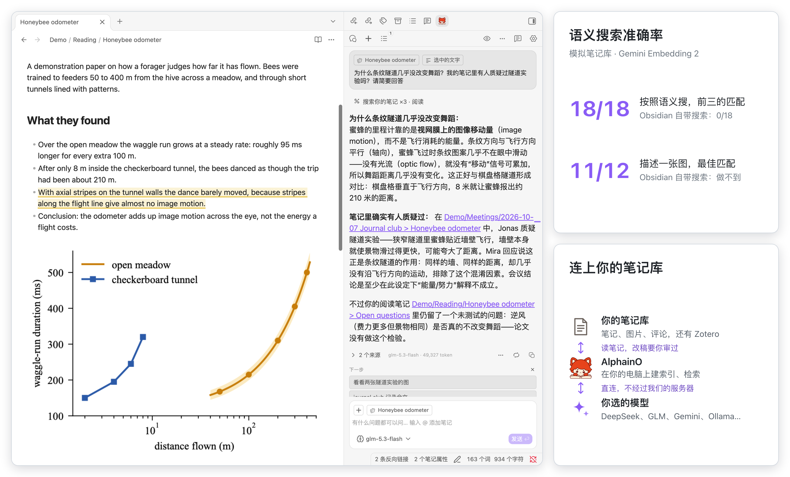

<p align="center">
  <picture>
    <source media="(prefers-color-scheme: dark)" srcset="docs/images/header-zh-dark.svg">
    
  </picture>
</p>

<p align="center">
  <a href="https://github.com/Alphainfix/AlphainO/releases/latest"></a>
  <a href="https://obsidian.md"></a>
  <a href="LICENSE"></a>
</p>

<p align="center">
  <a href="https://alphain.app/o/">网站</a> ·
  <a href="https://github.com/Alphainfix/AlphainO">GitHub</a> ·
  <a href="https://github.com/Alphainfix/AlphainO/releases/latest">下载</a> ·
  <a href="https://github.com/Alphainfix">作者：Alphainfix</a>
</p>

<p align="center"><a href="README.md">English</a> · <b>简体中文</b></p>

**开源免费，随你定制。** AlphainO 是装在 Obsidian 里的研究助手，用你自己的模型和 API key 和它聊你的笔记，不用注册账号。它是 [AlphainZ](https://github.com/Alphainfix/AlphainZ)（Zotero 里的那个助手）的 Obsidian 版：两个共用一套模型层和对话界面，还能[一起用](#和-zotero-里的-alphainz-协作)，一个问题可以同时查你的笔记和文献。问题从你的电脑直接发给你选的模型厂商，中间不经过别人的服务器，方便、安全、[省钱](#成本)。

<p align="center">
  
</p>

## 能做什么

### 问你的整个笔记库

AlphainO 会自己决定怎么找，几种方式一起用：

- **笔记的向量索引。** 每篇笔记切成段落做嵌入，可以用云端模型（Gemini Embedding 2、OpenAI），也可以用你电脑上的模型（Ollama 里的 EmbeddingGemma 2）。检索按语义匹配：换个说法、甚至换一种语言问，也能匹配到意思相同的段落。索引在后台自动建，可以关掉。
- **按语义找图。** 嵌入模型也能看图时，库里的图片也会建索引：描述一张截图、照片或图表，AlphainO 就能找到它，并在回答里直接显示出来。默认关闭，因为图片要发给嵌入模型的厂商。
- **回答带出处。** 引用笔记时链接到具体的标题（`[[笔记#标题]]`），点一下就跳过去。
- 还有关键词搜索，按标题、标签、属性、文件夹和日期找，以及笔记之间的链接和反向链接。

### 问你正在看的笔记

在编辑模式或阅读视图里选中一段话，右键选 **问 AlphainO 这段** 或 **解释**；也可以在侧栏里问整篇笔记，用「@」再加几篇进来。

### 答案留在段落上

从选中文字提的问题会锚定到那一段。回答好以后，对话底部会出现一张卡片，点一下就能把答案存成这一段的评论：笔记改了，评论照样跟着原来那段话，也跟着你的库同步。

### 改稿你来审

AlphainO 改笔记时，改动直接写进笔记，撤销一次就能退回。每一处改动都有标记，带「接受」和「拒绝」：像审代码合并请求一样，可以一处一处审，也可以一次全部接受或拒绝。

### 和 Zotero 里的 AlphainZ 协作

AlphainO 和 [AlphainZ](https://github.com/Alphainfix/AlphainZ) 是同一个助手的两个分身，可以合在一起用：

- **在笔记里查文献。** Zotero 开着、AlphainZ 的 MCP 服务器也打开时（AlphainZ：设置 → 高级 → MCP 服务器），AlphainO 就能用 AlphainZ 的文献库工具：按元数据、主题或全文的意思搜索你的文献库，用文字描述找图，读论文、看页面，读你的高亮和批注。这样一个问题可以同时用上你的笔记和你的论文。
- **一样的用法。** 两边用同样的模型、同样的设置页和同样的对话界面，对话也存成同样的格式。在 设置 → Zotero 文献库（AlphainZ）里可以检查连接，也可以关掉。

### 还有

- **给段落写评论。** 右键就能给任意一段写评论。AlphainO 读评论时会连同对应的原文一起看，也能写评论、回复、标为已解决。评论每改一次就存一个小文件，所以在几台电脑之间同步也不会冲突。
- **多台电脑一起用。** 对话和评论是库里的文件，跟着你的库同步（Obsidian Sync、iCloud 云盘等）；API key 只留在填它的那台电脑上。
- **中英文界面。** 界面跟随 Obsidian 的语言。
- **给其他 AI 工具用。** 在 设置 → Claude（MCP） 里打开后，Claude Code 可以直接通过 HTTP 连上，Claude Desktop 通过 AlphainO 放在插件文件夹里的一个小桥接文件连上。Obsidian 开着时，它们就能按关键词、意思或元数据搜索你的库，用文字描述找图，读笔记和链接，读写评论，改稿也要你审过。
- **链接到对话。** 从对话的菜单里复制链接，贴进笔记里，点一下就打开那段对话。

## 语义的图片/文字搜索准确度

**模拟笔记库。** 专门为这个仓库写的 18 篇笔记和 12 张图（[`docs/benchmark`](docs/benchmark)）：围绕 AlphainZ 那 6 篇模拟论文的读书笔记、想法和组会记录，3 篇不相干的个人笔记，以及贴进笔记里的 12 张论文插图。每个主题都有好几篇笔记，问题要在相近的笔记里找对那一篇。36 个问题直接跑 AlphainO 的检索，不经过语言模型。按语义搜的问题都刻意不用笔记原文的词，只能靠语义匹配；描述图片的 12 个问题原样用的是 AlphainZ 的找图问题：

| 问题 | AlphainO +<br>EmbeddingGemma&nbsp;2<br>（本地，免费） | AlphainO +<br>Gemini&nbsp;Embedding&nbsp;2<br>（用你自己的 API key） | Obsidian<br>自带搜索 |
|---|:-:|:-:|:-:|
| 按语义搜：英文提问（12） | 最佳匹配 10 个<br>前三匹配 12 个 | 最佳匹配 11 个<br>前三匹配 12 个 | 0 个匹配到 |
| 按语义搜：中文问英文笔记（6） | 最佳匹配 5 个<br>前三匹配 5 个 | 最佳匹配 4 个<br>前三匹配 6 个 | 0 个匹配到 |
| 描述一张图（12） | 最佳匹配 7 个<br>前三匹配 11 个 | 最佳匹配 11 个<br>前三匹配 12 个 | 做不到 |
| 原文关键词（6） | 5 个最佳匹配¹ | 6 个都是最佳匹配 | 6 个都匹配到 |

¹ 只按语义搜。AlphainO 也会按关键词搜，按关键词 6 个都排第一。

笔记里的图是单独建索引的。AlphainZ 是把 PDF 整页当成图，同样这 12 个描述，用 Gemini Embedding 2 有 6 次是最佳匹配，用 EmbeddingGemma 2 有 5 次。

## 和同类工具比

Copilot、Claudian 和 Smart Connections 是 Obsidian 插件目录里下载量最多的三个 AI 插件；YOLO 是 Smart Composer 还在维护的分支，功能上和 AlphainO 最接近。

| | AlphainO | Copilot | Claudian | Smart&nbsp;Connections | YOLO |
|---|:-:|:-:|:-:|:-:|:-:|
| 在 Obsidian 里用你自己的笔记库 | ✅ | ✅ | ✅¹ | 🟡 只能搜索² | ✅ |
| 按语义搜索整个笔记库 | ✅ | 🟡 要用 Miyo³ | ❌¹ | ✅ | ✅ |
| 描述一张图就能找到 | ✅ | 🟡 只认图里的文字³ | ❌¹ | – | ❌ |
| 改笔记，每处改动你来审 | ✅ | ✅ | ✅ | 🟡 仅 Pro⁴ | ✅ |
| 读写段落上的评论 | ✅ | 🟡 只在发布的页面上⁵ | – | – | ❌⁶ |
| 用你的 Zotero 文献库 | ✅ 通过 AlphainZ | – | – | – | – |
| 用自己的 API key、任意 OpenAI 兼容接口 | ✅ | ✅ | 🟡 通过各个智能体¹ | 🟡 仅 Pro² | ✅ |
| 通过 Ollama 用本地模型 | ✅ | ✅ | – | 🟡 仅 Pro² | ✅ |
| 不用账号、不用订阅 | ✅ | ✅⁷ | ✅ | 🟡 只有核心功能² | ✅ |
| 通过 MCP 给其他 AI 工具用 | ✅ | 🟡 要用 Miyo³ | ❌ | 🟡 仅 Pro⁴ | ✅ |
| 开源 | ✅ AGPL | ✅ AGPL⁸ | ✅ MIT | 🟡 只公开源码⁹ | ✅ MIT |

✅ 有 · 🟡 部分有 · ❌ 按该产品自己的页面没有 · – 没写。2026 年 11 月下旬根据各项目的 README、文档、价格页和源码核对，有错欢迎指正。<br>
¹ Claudian 运行你自己安装、登录的智能体命令行工具（Claude Code、Codex、OpenCode 等），把笔记库当作它们的工作文件夹；key 填在各个工具自己的设置里。它不建索引，智能体用自己的文件和文字搜索找文件。<br>
² Smart Connections 4 没有对话功能：它列出相关笔记，用本地模型按语义搜索。对话在单独的 Smart Chat 插件里，免费部分只是打开 ChatGPT、Claude 或 Gemini 的网页；用自己的 API key 或本地模型（包括 Ollama）要 Pro（每月 30 美元或每年 299 美元）。<br>
³ Copilot 4 把按语义搜索移到了同一家公司的独立桌面程序 Miyo 里，在自己电脑上用免费，源码没有公开。Miyo 能读图片里的文字；它的 MCP 连接器对本机的智能体免费，网页版或手机上的 ChatGPT、Claude 要付费的 Miyo 套餐。<br>
⁴ 付费的 Connect Pro 让其他智能体使用笔记库；它们提议的修改会先进收件箱等你批准，但它的其他写入工具会直接改笔记。<br>
⁵ 只在用付费套餐发布到 OpenArtifacts 的笔记上：别人在发布的页面上评论，智能体修改笔记、回复并标为已解决。<br>
⁶ YOLO 的路线图里有批注模式（在笔记上给出 AI 批注和建议）。<br>
⁷ 免费用法不需要账号、许可证或信用卡；Copilot 托管的模型、Quick Chat 自动搜索笔记和发布功能要付费。<br>
⁸ 插件本身是 AGPL；托管功能背后的服务器不开源，Miyo 的源码没有公开。<br>
⁹ Smart Plugins License 禁止把代码用在与之竞争的 Obsidian 产品里，所以只是公开源码，不算 OSI 意义上的开源。

NotebookLM、ChatGPT 或 Claude 的项目这类通用工具，回答的是上传到它们那里的笔记副本，在 Obsidian 之外，也不会写回你的笔记库。

## 模型

内置：DeepSeek、OpenRouter、智谱（BigModel）、Google Gemini、OpenAI，以及你电脑上的 Ollama。其他兼容 OpenAI 接口的服务，比如代理、机构网关、本地服务器，都可以手动添加，走 Chat Completions 或 Responses 接口。

模型设置和 AlphainZ 一样：每个模型都可以设置支持哪些思考档位（输入框的 Thinking 菜单就只列这些）、上下文窗口多大，以及一次回答最多用多少 token。

## 成本

AlphainO 本身免费，花的只是付给模型厂商的 token 费用。AlphainO 用的是 AlphainZ 的模型层，在那边按 62 个真实问题统计，每个问题平均读约 8 万 token（其中 83% 命中缓存）、写约 3 千 token。按官方标价估算：

| 模型 | 每个问题 | 一天狂聊 100 次 |
|---|:-:|:-:|
| DeepSeek V4.1 Flash | 约 $0.004<br>（高峰时段约 $0.008） | 约 $0.4 |
| OpenAI gpt-6-luna | 约 $0.004 | 约 $0.4 |

也就是说，一天高强度狂聊 100 次，成本也就 0.4 美元左右，不到 3 块钱。用 Ollama 跑本地模型完全免费。建索引另算：用本地的 EmbeddingGemma 2 免费；用 Gemini Embedding 2，笔记每 100 万 token 约 0.2 美元（大多数库都远不到 100 万），图片每 1000 张约 0.12 美元。

价格是 2026 年 11 月底的官方标价。DeepSeek 在工作日北京时间 9–12 点和 14–18 点按高峰价收费，贵一倍。

## 安装

1. 从[最新版本](https://github.com/Alphainfix/AlphainO/releases/latest)下载 `main.js`、`manifest.json` 和 `styles.css` 三个文件。
2. 放进 `<你的库>/.obsidian/plugins/alphaino/`，再到 设置 → 第三方插件 里打开 AlphainO。只支持电脑版，要 Obsidian 1.11.4 或更新。
3. 点左边栏的 AlphainO 图标打开，然后 设置 → AlphainO → 模型：添加服务商，贴上 key，选一个模型。

## 隐私

- 你的问题和回答需要的笔记内容，从你的电脑直接发给你选的模型厂商。没有 AlphainO 的服务器。
- 打开按语义搜索时，笔记会发给嵌入模型的厂商建索引；打开按画面找图后，图片也会先缩小再发过去。
- AlphainO 还会连你电脑上的程序：用 Ollama 时连 `127.0.0.1:11434`，连 Zotero（`127.0.0.1:23119`）是为了用 AlphainZ。MCP 服务打开后监听 `127.0.0.1:23129`，只回应本机发来的请求。
- API key 存在你填它的那台电脑上的 Obsidian 密钥存储里。插件的设置文件会跟着库同步，里面只记每个 key 的名字。
- 对话和评论是 `Agent/.alphaino/`（没有 Agent 文件夹时是库根目录的 `.alphaino/`）里的文件。这是隐藏文件夹，Obsidian 搜索时会跳过它。检索索引存在每台电脑上 Obsidian 自己的本地存储里。
- 没有遥测，不用账号，运行时不下载代码。除了这份本地存储，AlphainO 只读写你库里的东西。

## 从源码构建

```bash
git clone https://github.com/Alphainfix/AlphainO.git
cd AlphainO/plugin
npm ci
npm run build        # 生成 build/main.js、build/manifest.json 和 build/styles.css
npm test
npm run smoke        # 在模拟的 Obsidian 里接一个假的模型服务，把构建好的插件从头到尾跑一遍
```

和 AlphainZ 共用的代码复制在 [`plugin/shared/`](plugin/shared/README.md)。

## 更新记录

- **0.0.1**（2026-11-26）：第一版。

每一版的完整说明见[发布页](https://github.com/Alphainfix/AlphainO/releases)。

## 许可证

AlphainO 是自由软件，和它共用代码的 AlphainZ、Beaver 一样，使用 [GNU Affero 通用公共许可证 v3.0 或更新版本](LICENSE)。

- [AlphainZ](https://github.com/Alphainfix/AlphainZ)：模型层、对话界面和模型设置。
- [Beaver](https://github.com/jlegewie/beaver-zotero)，Joscha Legewie：AlphainZ 所基于的插件。
- Orbit Comments：评论的锚点和文件格式（MIT 许可，版权声明保留在 `plugin/src/comments/anchor.ts`）。

对比表来源：[Copilot](https://github.com/logancyang/obsidian-copilot)、[Claudian](https://github.com/YishenTu/claudian)、[Smart Connections](https://github.com/brianpetro/obsidian-smart-connections) 和 [smartconnections.app](https://smartconnections.app)、[YOLO](https://github.com/Lapis0x0/obsidian-yolo)；下载量来自 Obsidian 的 [community-plugin-stats.json](https://github.com/obsidianmd/obsidian-releases)。
